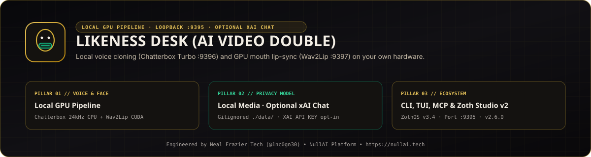

<div align="center">
  
</div>

# Likeness Desk (`v2.6.0`)

**Local GPU Voice Cloning & Lip-Synchronized Avatar Workstation (`127.0.0.1:9395`)**

[](#architecture--endpoints)
[](#quickstart)
[](#security--privacy-model)
[](LICENSE)
[](https://zoth.nullai.tech/tools/likeness-desk)

---

## What It Does

**Likeness Desk** runs a local audio-visual video double pipeline on your own hardware without uploading voice samples, portraits, or motion takes to third-party servers. A hardened Node.js loopback coordinator (`server.js` on `127.0.0.1:9395`) orchestrates two local Python workers:

- **Voice Synthesis Worker (`engine/voice_worker.py`, `:9396`)**: Conditions on a 6–40 second reference voice clip (`24 kHz` mono WAV normalized via `ffmpeg`) using local neural TTS (Chatterbox Turbo on CPU).
- **Lip-Sync Render Worker (`engine/face_worker.py`, `:9397`)**: Renders lip-synchronized MP4 frames over a still portrait or moving take using local `Wav2Lip` GAN weights (`models/wav2lip_gan.pth`) with SHA-256 checkpoint verification and normalized mouth ROI bounds (`x+w <= 1`, `y+h <= 1`).
- **Dual-Theme Workstation & Studio Sync**: Standalone `:9395` ships Editorial Ivory Light Mode and Obsidian Gold Dark Mode with `?embed=1&theme=light|dark` and `postMessage` theme synchronization for Zoth Studio v2.

---

## Architecture & Endpoints

| Component | Default Binding | Purpose |
| :--- | :--- | :--- |
| **Coordinator (`server.js`)** | `http://127.0.0.1:9395` | Serves dual-theme UI, enforces loopback `Host` & exact-port `Origin` allowlists, and manages worker lifecycle |
| **Voice Worker (`voice_worker.py`)** | `http://127.0.0.1:9396` | Trains reference voice embeddings and synthesizes `audio/wav` lines on CPU |
| **Face Worker (`face_worker.py`)** | `http://127.0.0.1:9397` | Renders lip-synced `video/mp4` frames against calibrated mouth ROI on CUDA GPU |
| **MCP Server (`bin/likeness-desk-mcp`)** | `stdio` (JSON-RPC 2.0) | Exposes 4 local tools (`likeness_status`, `likeness_mouth_roi`, `likeness_speak`, `likeness_diagnostics`) |

### Core HTTP Routes (`127.0.0.1:9395`)
- `GET` / `HEAD` `/health`, `/api/health` — Service liveness, version (`2.6.0`), mode (`lazy_gpu` / `active`), and worker readiness.
- `GET` / `HEAD` `/api/status` — Voice model status, portrait/motion availability, mouth ROI coordinates, GPU device name, and optional chat status.
- `POST /api/voice` — Normalize uploaded audio via `ffmpeg` (`24 kHz` mono, 6–40s, unique temp files, 30s timeout) and train local voice conditioning.
- `POST /api/face` — Store JPEG/PNG portrait locally in `LIKENESS_DATA_DIR/face/portrait.jpg`.
- `POST /api/idle`, `POST /api/motion` — Validate WebM EBML magic header (`0x1A 0x45 0xDF 0xA3`) and save local motion clips.
- `POST /api/mouth` — Validate and persist normalized `[x, y, w, h]` mouth ROI (`0 <= x,y <= 1`, `w >= 0.04`, `h >= 0.03`, `x+w <= 1`, `y+h <= 1`).
- `POST /api/speak` — Synthesize spoken `audio/wav` (or honest JSON metadata returning `mode: "lazy_preview", synthesized: false` when `LIKENESS_LAZY_GPU=1` vs `mode: "synthesized", synthesized: true` when workers are active).
- `POST /api/face/render` — Render lip-synchronized `video/mp4` from input WAV bytes.

---

## Security & Privacy Model

1. **Loopback Binding, `Host` & Exact-Port `Origin` Enforcement**: `server.js` binds strictly to loopback (`127.0.0.1`), rejects non-loopback `Host` headers (`403 Forbidden`), permits CORS strictly for `:9395` and Studio `:3000`, emits `X-Frame-Options`, `X-Content-Type-Options`, `Referrer-Policy`, and loopback `Content-Security-Policy`, and enforces clean HTTP `413 Payload Too Large` limits.
2. **Gitignored Biometric Storage**: All recorded audio, portraits, motion clips, and `profile.json` live under `./data/` (configurable via `LIKENESS_DATA_DIR`), which is gitignored and never shipped in ZothOS ISO images.
3. **Honest Optional Egress**: Voice cloning and Wav2Lip rendering run 100% locally. Optional conversational replies (`/api/chat`, configurable via `LIKENESS_CHAT_MODEL`) contact `api.x.ai` ONLY when `XAI_API_KEY` is explicitly set in the host environment. The optional browser `Listen` button uses the browser's built-in `SpeechRecognition` API if invoked.
4. **Graceful Subprocess Cleanup & Checkpoint Integrity**: `server.js` terminates spawned Python workers on `SIGINT`/`SIGTERM`/`exit`; `face_worker.py` verifies `wav2lip_gan.pth` SHA-256 against `LIKENESS_WAV2LIP_SHA256` (or `.sha256` sidecar) before loading weights.

---

## Quickstart & ZothOS CLI / MCP Commands

```bash
# 1. Clone and launch in lazy-GPU preview mode (safe on laptops without warming CUDA)
git clone https://github.com/1nc0gn30/likeness-desk.git
cd likeness-desk
LIKENESS_LAZY_GPU=1 node server.js

# Or start full CPU voice + CUDA lip-sync workers:
node server.js --port 9395
```

### ZothOS CLI, TUI & MCP Commands

```bash
likeness-desk --help
likeness-desk --status
likeness-desk --json
likeness-desk --ui
likeness-desk serve --port 9395 --lazy-gpu
likeness-desk speak "Local AI video double verification."
likeness-desk-tui --status
likeness-desk mcp   # Launches JSON-RPC 2.0 stdio MCP server (4 tools)
```

---

## Testing & Verification

All tests run in an isolated ephemeral directory (`LIKENESS_DATA_DIR` / `LIKENESS_PUBLIC_DIR`) with synthetic fixtures so personal biometric files are never touched:

```bash
LIKENESS_LAZY_GPU=1 python3 -m pytest -v
```

---

## License & Attribution

Licensed under the [MIT License](LICENSE). 100% free and open-access software with zero paywalls, login gates, or telemetry.

Optional voluntary support:
- **Stripe**: [☕ Buy Us a Coffee](https://buy.stripe.com/3cIfZg27PdKo2D64Ocfw40X)
- **Solana Tip Address**: `GG2eQbVh8ut1BK6j1A2tz7pSySdLpD38BgyEhGcxdXoK` (`solana:GG2eQbVh8ut1BK6j1A2tz7pSySdLpD38BgyEhGcxdXoK`)

Engineered by **Neal Frazier Tech** ([@1nc0gn30](https://github.com/1nc0gn30) • [https://github.com/1nc0gn30/likeness-desk](https://github.com/1nc0gn30/likeness-desk)) • **NullAI Platform** ([https://nullai.tech](https://nullai.tech)).
