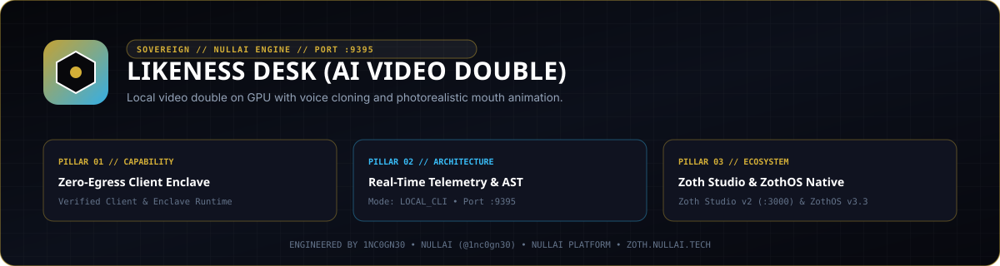

<div align="center">
  
</div>

# Likeness Desk

**Local GPU Voice Cloning & Lip-Synchronized Avatar Workstation (`127.0.0.1:9395`)**

[](#architecture--endpoints)
[](#quickstart)
[](#security--privacy-model)
[](https://zoth.nullai.tech/tools/likeness-desk)

---

## Overview

**Likeness Desk** runs a local audio-visual avatar pipeline on your own GPU without uploading voice samples or portrait media to external cloud services. A lightweight Node.js loopback server (`server.js` on `127.0.0.1:9395`) coordinates two local Python workers:

- **Voice Synthesis Worker (`engine/voice_worker.py`, `:9396`)**: Clones a 6–40 second reference voice clip (`24 kHz` mono WAV via `ffmpeg`) using local neural TTS (Chatterbox Turbo).
- **Lip-Sync Render Worker (`engine/face_worker.py`, `:9397`)**: Animates mouth regions (`ROI` bounding box) over a still JPEG portrait or motion take using local `Wav2Lip` GAN weights (`models/wav2lip_gan.pth`).

---

## Architecture & Endpoints

| Component | Default Binding | Purpose |
| :--- | :--- | :--- |
| **Coordinator (`server.js`)** | `http://127.0.0.1:9395` | Serves local operator UI, enforces loopback-only origin checks, and orchestrates workers |
| **Voice Worker (`voice_worker.py`)** | `http://127.0.0.1:9396` | Trains reference voice embeddings and synthesizes `audio/wav` lines |
| **Face Worker (`face_worker.py`)** | `http://127.0.0.1:9397` | Renders lip-synced `video/mp4` frames against configured mouth ROI |

### Core HTTP Routes (`127.0.0.1:9395`)
- `GET /health` — Service liveness, uptime, and worker readiness.
- `GET /api/status` — Voice model status, portrait/motion availability, mouth ROI coordinates, and GPU device name.
- `POST /api/voice` — Normalize uploaded audio via `ffmpeg` (`24 kHz` mono, 6–40s) and trigger local voice training.
- `POST /api/face` — Store JPEG/PNG portrait locally in `./data/face/portrait.jpg`.
- `POST /api/mouth` — Persist normalized `[x, y, w, h]` mouth region coordinates to `./data/profile.json`.
- `POST /api/speak` — Synthesize spoken WAV audio (or JSON metadata when `Accept: application/json` is set).
- `POST /api/face/render` — Render lip-synchronized MP4 output from input WAV bytes.

---

## Security & Privacy Model

1. **Loopback Binding & Cross-Origin Protection**: `server.js` binds strictly to `127.0.0.1` and rejects cross-origin browser requests (`403 Forbidden`) so external websites cannot probe local portraits or trigger synthesis.
2. **Gitignored Biometric Storage**: All recorded audio, portraits, motion clips, and `profile.json` live under `./data/`, which is gitignored by default.
3. **Optional Conversational LLM**: Spoken line synthesis works 100% offline. Optional conversational replies (`/api/chat`) only activate if `XAI_API_KEY` is explicitly set in the host environment.

---

## Quickstart

```bash
# 1. Clone the repository
git clone https://github.com/1nc0gn30/likeness-desk.git
cd likeness-desk

# 2. Launch the loopback coordinator on http://127.0.0.1:9395
node server.js

# Optional: Run in lazy-GPU preview mode (without spawning CUDA workers on boot)
LIKENESS_LAZY_GPU=1 node server.js
```

On ZothOS v3.4.0, the CLI wrapper is pre-installed at `/usr/local/bin/likeness-desk`:

```bash
likeness-desk --help
likeness-desk --json
```

---

## Testing & Verification

The automated `pytest` suite provisions an ephemeral sandbox (`LIKENESS_DATA_DIR` / `LIKENESS_PUBLIC_DIR`) with synthetic PCM WAV, JPEG, and MP4 fixtures so tests pass deterministically on clean checkouts and CI runners without biometric files:

```bash
python3 -m pytest -v
```

---

## License & Attribution

100% free and open-source software with zero paywalls or telemetry.  
Optional patronage: [Buy Us a Coffee (Stripe)](https://buy.stripe.com/3cIfZg27PdKo2D64Ocfw40X)

Engineered by **1nc0gn30** ([@1nc0gn30](https://github.com/1nc0gn30) • [https://1nc0gn30.si](https://1nc0gn30.si)) • **NullAI** ([https://nullai.tech](https://nullai.tech)).
